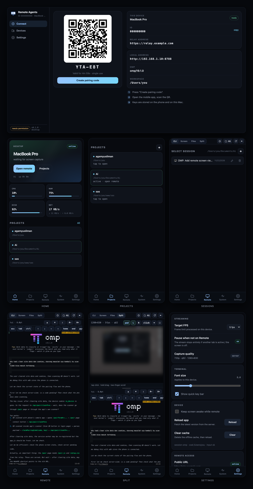

# Remote Agents

Self-hosted remote desktop **and** agent chat/terminal for your phone or tablet.
Rust server + PWA. No cloud account, no third-party service in the loop.

## The problem this solves

If you build software by prompting an agent — `omp`, or any other CLI agent — the
machine that does the work is usually the one sitting at home. The moment you
leave the house, the loop breaks:

- You can still send a prompt, but you cannot **see** what the agent is doing.
  When it opens a browser, an emulator, or a preview server, that window exists
  on a screen you are not looking at.
- You cannot take over. The agent stalls on a dialog, clicks the wrong element,
  or needs one drag of the mouse — and you are four kilometres away.
- Chat-only mobile clients show you text. They cannot show you the thing the
  agent is actually building.

So the agent keeps running, but you are no longer in the loop.

## What this does

Remote Agents puts the **whole device** on your phone: the screen, the mouse,
the keyboard, the terminal, and the agent's own chat — in one PWA.

- The agent keeps running at home, on real hardware, with your real projects.
- You watch the screen it is driving, including browsers and emulators.
- You send prompts from anywhere, and you can take the mouse when it matters.
- Nothing routes through a vendor: your Mac serves the app, an optional nginx
  relay gives it a hostname.

That is the difference between "my agent is still running" and "I am still
driving my agent".

<a href="docs/screenshots.md"></a>

More in [docs/screenshots.md](docs/screenshots.md).

> **Public repo.** No tokens, device keys, or server addresses here.
> Real configuration lives in `data/` and `relay/devices.json`, both
> `.gitignore`d. Read [docs/security.md](docs/security.md) before deploying.

## Features

| Feature | Description |
|---|---|
| **Screen** | ScreenCaptureKit via `scap`, JPEG ~5 fps over WebSocket, input via `enigo` |
| **Agent chat** | RPC bridge (`omp --mode rpc-ui`), model picker, session resume, ask form |
| **Terminal** | real PTY via `portable-pty` + tmux + xterm.js |
| **Sessions** | list, resume, rename, and delete sessions without leaving the project |
| **Projects** | allowlisted library; add by picking a folder, remove from the list |
| **Files** | tree explorer, code viewer, markdown preview |
| **System** | CPU, RAM, disk, network, top processes |
| **PWA** | installs on iOS/Android; service worker caches the shell only |
| **Battery saver** | capture stops when nobody is watching, identical frames are skipped |

## Requirements

- macOS 12.3+ (ScreenCaptureKit), Rust 1.85+
- [`omp`](https://github.com/) installed (default `/opt/homebrew/bin/omp`)
- `tmux`
- Optional: a VPS for the relay (nginx), `cloudflared` or `tailscale`

## Quick start

```sh
git clone https://github.com/agamyusliman/remote-desktop-agents.git
cd remote-desktop-agents
./scripts/setup.sh          # create data/, token, .env
$EDITOR .env                # set OMP_CWD and ALLOWED_ROOTS
cargo build --release
set -a; source .env; set +a
./target/release/remot-agent
```

Or use the desktop app:

```sh
./scripts/package-macos.sh --install   # → /Applications/Remote Agents.app
```

Then:

1. Open the app, allow **Screen Recording** and **Accessibility**, then relaunch.
2. **Connect** tab → **Create pairing code**.
3. Scan the QR from your phone, or type the code.

Full guide: [docs/getting-started.md](docs/getting-started.md).

## Access from outside your home

Never expose port `8788` to the internet. Options:

| Method | Notes |
|---|---|
| nginx relay on a VPS | one hostname for several Macs — [docs/relay.md](docs/relay.md) |
| Tailscale | `tailscale serve 8788`, private, no domain |
| Cloudflare named tunnel | `./scripts/setup-named-tunnel.sh remote.yourdomain.com` |
| Quick tunnel | `./scripts/tunnel.sh`, random URL for testing |

## More agents are the point

`omp` is the first agent, not the only one. The server already splits the two
things an agent integration needs:

| Concern | Where it lives |
|---|---|
| Conversation transport | `src/rpc.rs` — a JSON request/response bridge over a child process |
| Interactive surface | `src/terminal.rs` — a real PTY that any CLI can occupy |
| Session discovery | `src/projects.rs` + the agent's own session directory |
| Approvals and questions | the `ask` form in `public/app.js`, fed by RPC events |

Supporting another CLI agent means writing a small adapter that speaks that
agent's chat protocol, or falling back to the PTY when it has none. The phone UI
does not need to know which agent is behind it.

Planned direction:

- multiple agent backends selectable per project, not one global binary;
- session listing for agents that store history differently;
- a documented adapter contract so a new agent can be added without touching the
  PWA.

## Contributing

Contributions are welcome — especially new agent adapters, relay/transport
improvements, and mobile UX fixes.

- Read [docs/contributing.md](docs/contributing.md) for code rules and the PR flow.
- Keep credentials out of commits: `data/`, `.env`, and `relay/devices.json` are
  ignored; use `.env.example` and `relay/devices.example.json` as templates.
- If you are adding an agent, open an issue first describing the protocol it
  exposes (RPC, stdio, or PTY-only) so the adapter boundary stays consistent.

## Security in brief

- Session cookies are HMAC-signed (`HttpOnly`, `Secure`); pairing clients use
  a bearer key stored on the phone and in `clients.json` on the Mac.
- Every file endpoint is restricted by `ALLOWED_ROOTS`.
- The relay rejects `/api/*` without a device cookie with `401 JSON`, not a page.
- Remove a device from the list in the desktop app to cut off access.
- Rotate every credential: `./scripts/rotate-token.sh --restart`.

Threat model details: [docs/security.md](docs/security.md).

## Documentation

| Document | Contents |
|---|---|
| [docs/getting-started.md](docs/getting-started.md) | install, macOS permissions, UI flow, first steps |
| [docs/pairing.md](docs/pairing.md) | pairing flow, QR contents, cookies, revoke |
| [docs/relay.md](docs/relay.md) | one hostname for several Macs |
| [docs/access.md](docs/access.md) | token, rotation, emergency access |
| [docs/configuration.md](docs/configuration.md) | env vars, data directory contents, client preferences |
| [docs/architecture.md](docs/architecture.md) | code structure and data flow |
| [docs/api.md](docs/api.md) | HTTP endpoints, WebSocket, session format |
| [docs/security.md](docs/security.md) | threat model and limits |
| [docs/troubleshooting.md](docs/troubleshooting.md) | common symptoms and causes |
| [docs/contributing.md](docs/contributing.md) | code rules and PR flow |
| [docs/screenshots.md](docs/screenshots.md) | desktop and mobile screenshots |

## Layout

```
src/        Rust server (axum): capture, input, terminal, rpc, pairing, auth
public/     PWA: index.html, app.js, style.css, sw.js, vendor/
relay/      nginx config + example devices
scripts/    setup, packaging, tunnel, relay, token rotation
docs/       documentation
data/       runtime state — NOT committed
```

## License

MIT — see [LICENSE](LICENSE).
