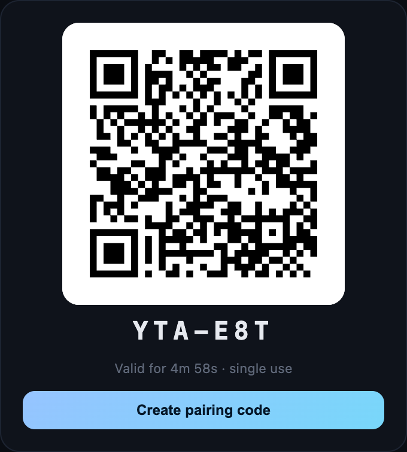
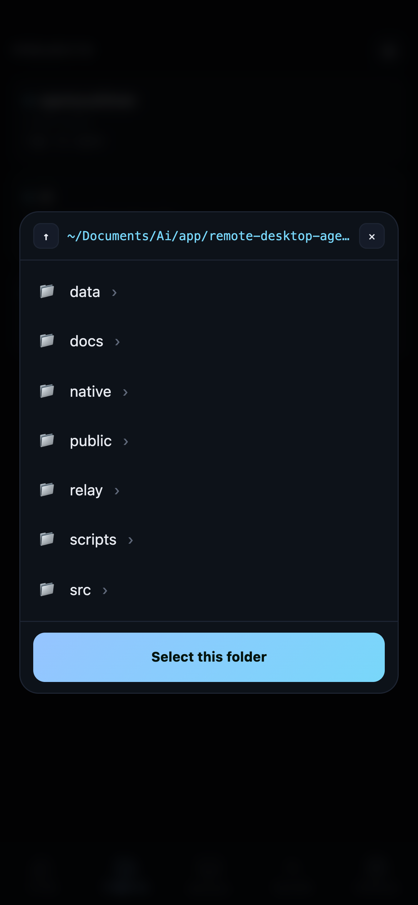
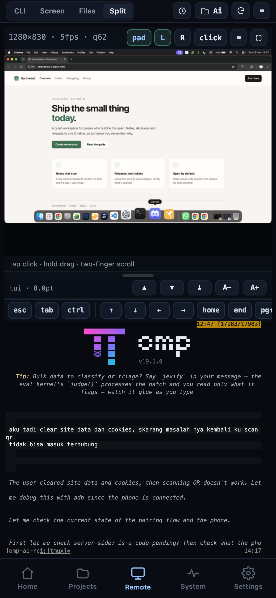

# Screenshots

The desktop app handles pairing and permissions; the PWA is the remote itself.

## Desktop app

| Connect + pairing QR | Pairing code close-up |
|---|---|
|  |  |

## Mobile — 3 × 3

| Home | Projects | Sessions |
|---|---|---|
|  |  |  |
| **Add project** | **Remote (CLI)** | **Split** |
|  |  |  |
| **Markdown preview** | **Code viewer** | **Settings** |
|  |  |  |

## Notes on these captures

- Device ID, hostname, local IP and paths are placeholders; the relay address is
  `relay.example.com`. A real deployment shows your own values.
- The screen area in Split shows a neutral demo page, not the machine that
  produced these captures.
- The pairing code is single-use and expired when you read this.
- Split is stacked here because the phone is in portrait; in landscape it becomes
  screen left, terminal right.
