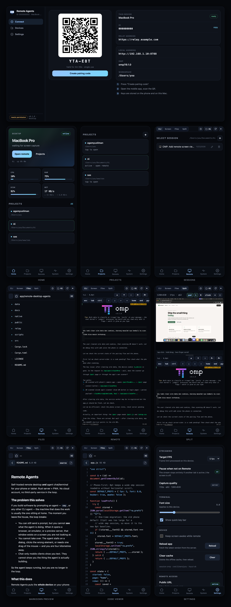
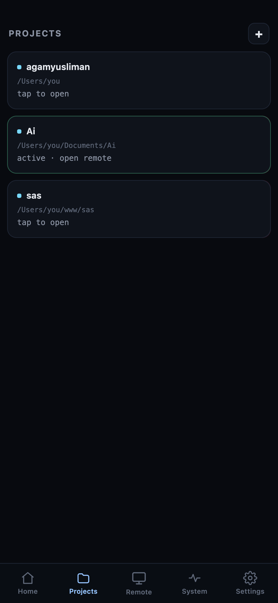
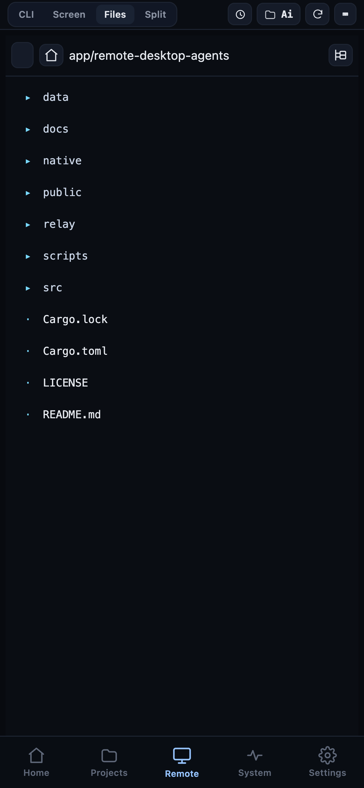
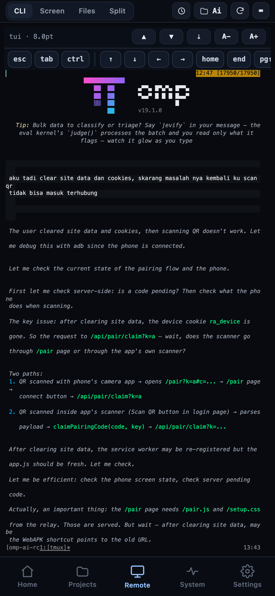
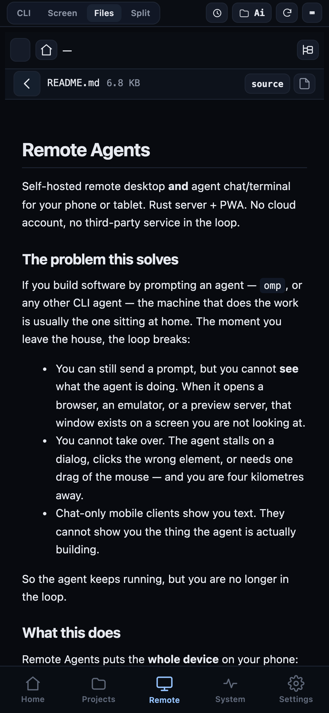
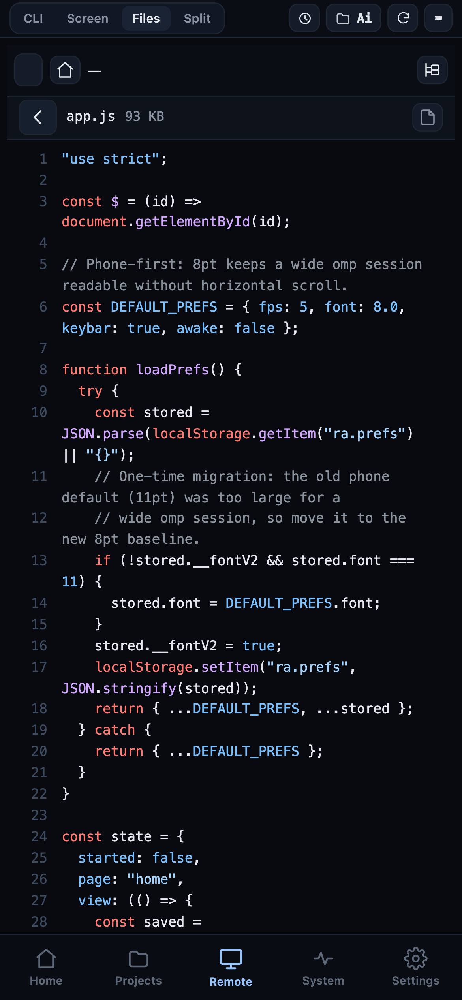
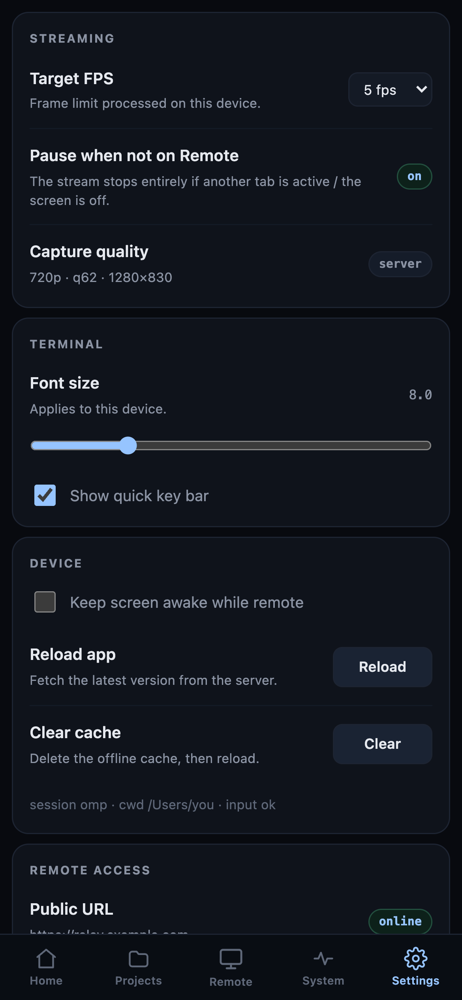

# Screenshots

The desktop app handles pairing and permissions; the PWA is the remote itself.

## Desktop app

| Connect + pairing QR | Pairing code close-up |
|---|---|
|  |  |

## Mobile — 3 × 3

Every capture is 1170 × 2532 and rendered at a fixed width here, so the grid
stays even no matter how the table is laid out.

<table>
  <tr>
    <td align="center" width="33%"> Home</td>
    <td align="center" width="33%"> Projects</td>
    <td align="center" width="33%"> Sessions</td>
  </tr>
  <tr>
    <td align="center"> Files</td>
    <td align="center"> Remote (CLI)</td>
    <td align="center"> Split</td>
  </tr>
  <tr>
    <td align="center"> Markdown preview</td>
    <td align="center"> Code viewer</td>
    <td align="center"> Settings</td>
  </tr>
</table>

## Notes on these captures

- Device ID, hostname, local IP and paths are placeholders; the relay address is
  `relay.example.com`. A real deployment shows your own values.
- The file tree is scoped to this repository, not to the author's home directory.
- The screen area in Split shows a neutral demo page, not the machine that
  produced these captures.
- The pairing code is single-use and expired when you read this.
- Split is stacked because the phone is in portrait; in landscape it becomes
  screen left, terminal right.
- Source files are coloured with highlight.js (vendored in `public/vendor`).
